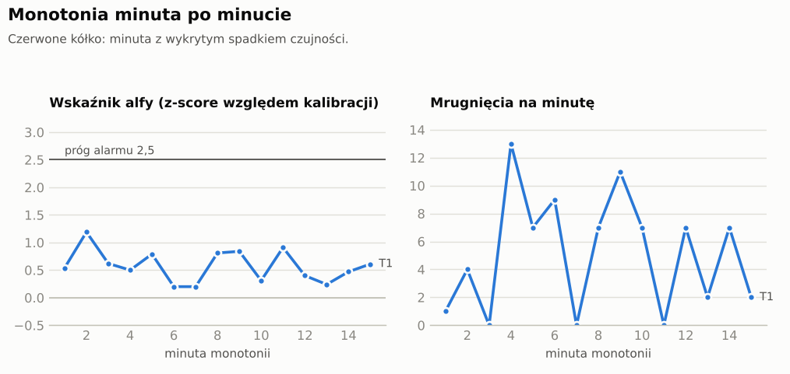

# Sesja monotonii: Wojtek, T1 (14.11.2026, 21:16)

Pierwszy własny pomiar z blokiem monotonii (zadanie C4, wariant dla jednej osoby z [`protokol-nocny.md`](protokol-nocny.md)).
Studium przypadku: jedna osoba, jedna sesja, bez testu reakcji PVT. Liczby policzył
`experiments/analyze-night-checkpoint.py` tym samym kodem, który działa w demo.

## Przebieg

- Protokół: 60 s oczy otwarte (kalibracja), 60 s oczy zamknięte, 60 s liczenie, **15 min monotonii** z otwartymi oczami.
- Warunki: słuchawki z ANC i biały szum, wzrok w jeden punkt, wieczorem po całym dniu hackathonu.
- Ocena senności po sesji: **KSS 5** (ani czujny, ani senny).
- Garmin Venu 2 z paskiem HRM (aktywność „Yoga”, 18 min 37 s): tętno średnio **96**, maks. 120; oddech 13 na minutę (11–15);
  stres Garmina 82 → 79, średnio 78. Z zegarka mamy tylko podsumowanie, bez przebiegu minutowego.

## Wyniki

| | Wartość |
|---|---|
| Okna odrzucone jako artefakty (cała sesja / monotonia) | 0,7% / 0,9% |
| Zamknięcie oczu wykryte | tak, ok. 9 s po zamknięciu |
| Wskaźnik alfy w monotonii: pierwsze 2 min → ostatnie 2 min | 0,88 → 0,54 (z-score względem kalibracji) |
| Najwyższa średnia minutowa w monotonii | 1,19 (próg alarmu: 2,5) |
| Spadki czujności w monotonii | 0 |
| Okna nad progiem próby reakcji (1,5) | 11,5% |
| Próby reakcji, które obecny system wywołałby w monotonii | 11 w 15 min (ok. 44 na godzinę) |
| Mrugnięcia na minutę w monotonii | od 0 do 13, bez trendu |

Nagranie ruszyło w BrainAccess Board ok. 3 s przed startem narzędzia sesji, więc adnotacje są przesunięte o 3 s.
Przesunięcie sprawdziliśmy na sygnale: alfa rośnie ok. 65 s od początku pliku i spada ok. 123 s, zgodnie z blokiem oczu zamkniętych.

## Wnioski

1. **Senności w tej sesji nie było, i EEG to pokazuje.** Wskaźnik alfy przez 15 minut wahał się blisko poziomu z kalibracji,
   bez trendu w górę. Zgadza się to z KSS 5 i z wysokim tętnem i stresem z zegarka, które wskazują raczej na pobudzenie
   (dzień hackathonu) niż na senność. To wynik zerowy dla senności, a nie dowód, że wskaźnik ją wykrywa.
2. **Zero fałszywych alarmów przez 15 minut z otwartymi oczami** przy bardzo czystym sygnale (0,9% odrzuconych okien wobec
   3–15% w nagraniach z południa). Wskaźnik ani razu nie zbliżył się do progu alarmu.
3. **Zamknięcie oczu nadal działa:** wykryte ok. 9 s po zamknięciu, w przedziale 7–13 s z wcześniejszych nagrań.
4. **Próba reakcji wywoływana podprogowym wzrostem alfy pojawiałaby się zbyt często:** 11 razy w 15 minut bez żadnego spadku
   czujności. To potwierdza wniosek z notebooka 06 i propozycję z issue #14 (próba z harmonogramu albo po zdarzeniu, a nie z podprogowej alfy).
5. **Jedno zamknięcie oczu rozpadło się na dwa spadki czujności** (krótka przerwa w środku bloku). Potwierdza to problem opisany w issue #11.

## Ograniczenia

- Jedna osoba, jedna sesja. Bez porównania z drugą sesją (`T2`) i bez testu reakcji.
- Kalibracja to pierwsza minuta tej samej sesji, więc wskaźnik pokazuje zmianę względem początku sesji, a nie względem stanu wypoczętego.
- Z zegarka tylko podsumowanie aktywności; przebieg tętna minuta po minucie wymaga pliku `.fit`.

## Co wolno powiedzieć

- „W 15-minutowej monotonii przy KSS 5 system nie zgłosił ani jednego fałszywego alarmu, a zamknięcie oczu nadal wykrywał w ok. 9 s.”
- Nie wolno: że sesja pokazała wykrywanie senności. Senności w niej nie było.
