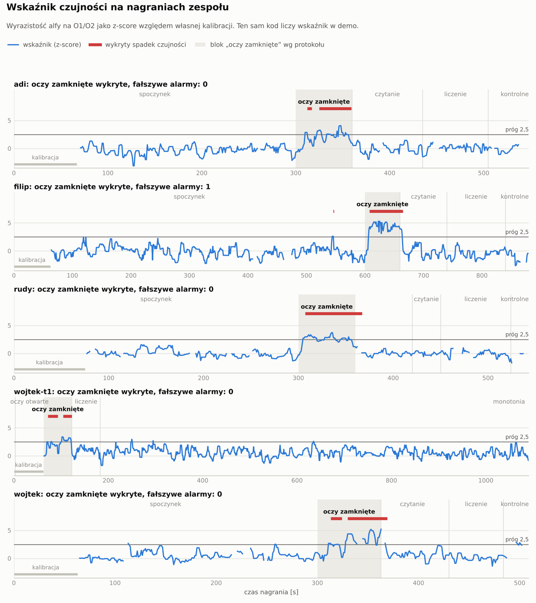

# Trafność pipeline'u na nagraniach zespołu

Stan na 14.11.2026, noc. To wynik skryptu `experiments/validate-on-recordings.py` na pięciu nagraniach z `data/recordings/`
(cztery z południa i sesja monotonii Wojtka `wojtek-t1`).

## Co sprawdzamy

- Nagranie przechodzi od początku do końca przez ten sam kod, który liczy wskaźnik w demo:
  filtr przyczynowy 1–40 Hz, okna 2 s co 1 s, kalibracja z pierwszych 60 czystych okien.
- „Spadek czujności” to wyrazistość alfy na O1/O2 powyżej 2,5 odchylenia od własnej kalibracji przez co najmniej 3 s.
- Punktem odniesienia jest blok `eyes_closed` z adnotacji protokołu. Dobrowolne zamknięcie oczu zastępuje tu prawdziwy mikrosen.

## Wynik

| Osoba | Okna odrzucone | Oczy zamknięte wykryte | Opóźnienie | Pokrycie bloku | Fałszywe alarmy | Czas w fałszywym alarmie | AUC |
|---|---|---|---|---|---|---|---|
| adi | 10,1% | tak | 12 s | 69% | 0 w 7,0 min | 0,0% | 0,93 |
| filip | 3,2% | tak | 8 s | 90% | 1 w 12,6 min | 0,8% | 0,97 |
| rudy | 15,3% | tak | 7 s | 92% | 0 w 5,8 min | 0,0% | 0,99 |
| wojtek-t1 | 0,7% | tak | 9 s | 71% | 0 w 16,0 min | 0,0% | 0,88 |
| wojtek | 10,8% | tak | 13 s | 74% | 0 w 6,3 min | 1,3% | 0,89 |

Razem: wykryto 5 z 5 bloków, 1 fałszywy alarm w 48 min poza blokiem (po kalibracji).



Kolumny:

- **Okna odrzucone:** odsetek okien 2 s z amplitudą powyżej 300 µV (ruch, mięśnie).
- **Opóźnienie:** od początku bloku według ręcznie spisanego timeline'u do zgłoszenia spadku.
- **Pokrycie bloku:** odsetek okien bloku `eyes_closed`, w których stan to „spadek czujności”.
- **Fałszywe alarmy:** spadki zgłoszone poza blokiem `eyes_closed`, po zakończeniu kalibracji.
- **AUC:** jak dobrze sam wskaźnik (bez progu) oddziela okna z bloku `eyes_closed` od pozostałych; 0,5 to los, 1,0 to ideał.

## Jak czytać te liczby

- **To sprawdzenie mechanizmu, nie statystyka.** Cztery osoby, po jednym bloku na osobę.
- **Próg 2,5 dobraliśmy na tych samych nagraniach**, więc wynik jest optymistyczny. Przy progu 2,0 było 6 fałszywych alarmów
  zamiast jednego. Na nowych nagraniach z punktów pomiarowych trzeba to sprawdzić ponownie.
- **Opóźnienie zawiera niedokładność timeline'u.** Od chwili, gdy alfa po raz pierwszy przekracza próg w dwóch kolejnych
  oknach, do zgłoszenia mijają 4 s u każdej z czterech osób. Z tego 3 s to wymagane utrzymanie sygnału.
- **Zamknięte oczy to nie senność.** Alfa przy zamkniętych oczach jest najsilniejszym sygnałem, jaki ten sprzęt widzi.
  Prawdziwa senność daje słabsze zmiany. To uzupełni wykres z danych publicznych (zadanie B2).
- **Wskaźnik wolny i rezerwa nie są tu sprawdzane.** Ich parametry są założeniami.

## Stan oczu, zdarzenia i próby reakcji (zadania A7, A8, issues #11, #14)

Kamera w aucie sprawdza, czy oczy są zamknięte. Żeby odróżnić to od senności przy otwartych oczach, pipeline liczy
mrugnięcia na F3/F4 (przy referencji Fp1 mrugnięcie to krótkie, duże wychylenie). Spadek czujności bez mrugnięć jest
oznaczany jako „oczy zamknięte”, a spadek przy mrugających oczach jako „senność przy otwartych oczach”.

Mrugnięcia na minutę w blokach protokołu (detektor z `src/wachta/blinks.py`, próg z pierwszych 20 s nagrania).
Poprawione 14.11 wieczorem: wcześniejsza wersja liczyła część mrugnięć podwójnie, bo po filtrze 1 Hz mrugnięcie ma dwie fazy.

| Osoba | Rozmowa | Oczy zamknięte | Czytanie | Liczenie |
|---|---|---|---|---|
| adi | 3 | 0 | 7 | 9 |
| filip | 15 | 1 | 3 | 0 |
| rudy | 12 | 0 | 6 | 25 |
| wojtek | 11 | 10 | 1 | 0 |

| Osoba | Spadek w bloku oznaczony jako „oczy zamknięte” | Zdarzenia w bloku | „Stop” trwa po bloku | Próba reakcji po bloku | Próby bez wcześniejszego zdarzenia |
|---|---|---|---|---|---|
| adi | 100% okien | 1 | 0 s | po 12 s | 0 |
| filip | 100% okien | 1 | 5 s | po 18 s | 0 |
| rudy | 100% okien | 1 | 7 s | po 20 s | 0 |
| wojtek-t1 | 90% okien | 1 | 0 s | po 13 s | 0 |
| wojtek | 43% okien | 1 | 6 s | po 19 s | 0 |

Jak to czytać:

- **U trzech osób blok zamkniętych oczu jest prawie bez mrugnięć i cały oznaczony poprawnie.** U Wojtka detektor widzi serię
  wychyleń w 37.–41. s bloku i przy jego końcu. W tym samym miejscu spada jego alfa, więc to najpewniej krótkie otwarcie oczu,
  a nie błąd detektora. Bez nagrania wideo nie da się tego rozstrzygnąć.
- **Przy czytaniu i liczeniu ludzie mrugają rzadko** (u Filipa i Wojtka 0–3 razy na minutę). Same mrugnięcia nie wystarczą więc
  do oceny stanu oczu. Liczą się tylko razem ze wzrostem alfy.
- **Senności przy otwartych oczach nie da się tu sprawdzić**, bo nikt w tych nagraniach nie był senny. Dowody na nią pochodzą
  z danych publicznych (notebooki 04 i 05) i literatury (`podstawy-naukowe.md`). Własne dane mają dać nocne punkty pomiarowe (C4).
- **Jedno zamknięcie oczu to jedno zdarzenie** (issue #11): krótkie spadki alfy w środku bloku (6–11 s) nie dzielą go już na dwa.
  „Stop” trwa najwyżej 7 s po otwarciu oczu, potem stan wraca do „uwaga”.
- **Próba reakcji pojawia się po każdym bloku zamkniętych oczu, 12–20 s po otwarciu oczu, i nigdy bez wcześniejszego
  zdarzenia** (issue #14). Wcześniejsza wersja wywoływała próbę z podprogowego wzrostu alfy: do 8 prób na 10 minut poza blokiem
  i 11 w 15 minut monotonii Wojtka. Notebook 06 pokazał, że taki sygnał nie wyprzedza lapsów (AUC 0,52), więc go usunęliśmy.
  Do tego dochodzi próba z harmonogramu co 20 min (założenie, do dostrojenia w B8).
- Próba jest zaliczona względem osobistej normy: po trzech zaliczonych próbach progiem jest 1,5 × własna mediana czasu reakcji,
  wcześniej 355 ms (PVT-B).
- Czasu reakcji nie da się sprawdzić na nagraniach: próba wymaga człowieka przed ekranem.

## Jak odtworzyć

```bash
pip install -e ".[analysis]"
```

```bash
python experiments/validate-on-recordings.py --figure docs/img/trafnosc-na-nagraniach.png
```
